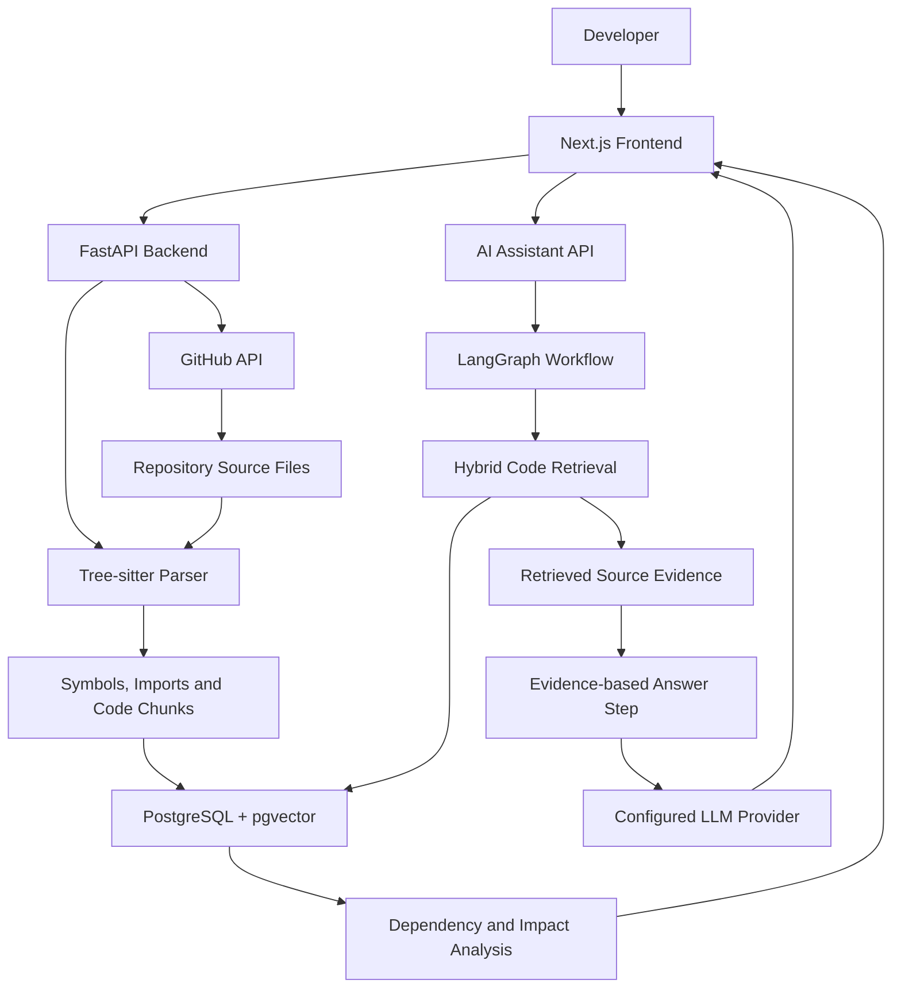
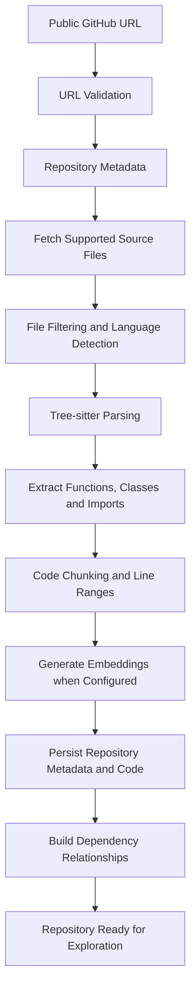
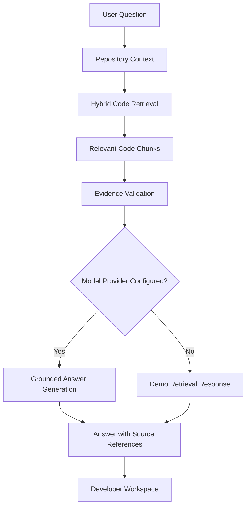

# RepoMind AI

RepoMind is a working repository-intelligence MVP: it indexes public GitHub source without executing it, extracts Python/JavaScript/TypeScript symbols and imports with Tree-sitter, stores code metadata in PostgreSQL/pgvector, and exposes cited code retrieval, dependency visualization and heuristic impact analysis.

## Architecture

The frontend is Next.js/React/TypeScript with Tailwind and React Flow. A Python FastAPI service owns public GitHub access, parsing, retrieval, provider calls and SQLAlchemy persistence. LangGraph controls a bounded two-node workflow: hybrid code retrieval, followed by an evidence-only answer step that either uses the configured provider or reports explicit demo evidence. PostgreSQL plus pgvector is the intended durable database. `docker-compose.yml` starts the database, API and web app together. The Manus-managed database service is MySQL, so this project intentionally uses PostgreSQL in Compose rather than silently changing the requested stack.

## Quick start: PostgreSQL and pgvector# RepoMind AI

### Repository Intelligence for Understanding, Exploring and Analyzing Codebases

RepoMind is an AI-powered repository intelligence platform that transforms unfamiliar codebases into structured, searchable and explorable engineering systems.

Connect a public GitHub repository, inspect its source structure, explore dependencies, trace module relationships and ask repository-specific questions using code-grounded retrieval.

Rather than treating a repository as a collection of isolated files, RepoMind builds a structured representation of its code, symbols and dependencies to make software systems easier to understand.

<p align="center">
  <a href="https://github.com/Quantumboy80/repomind-ai">
    
  </a>
  
  
</p>

---

## Overview

Understanding an unfamiliar codebase often requires manually navigating files, following imports, locating function definitions and reconstructing execution relationships.

RepoMind addresses this problem through a repository analysis pipeline that combines syntax-aware source extraction, structured metadata storage, code retrieval and dependency analysis.

The platform provides a unified workspace for:

- Indexing public GitHub repositories.
- Extracting functions, classes, methods and imports.
- Searching repository code with contextual retrieval.
- Asking questions about actual implementation details.
- Exploring module and file dependencies visually.
- Identifying potentially affected modules through dependency analysis.

The system is designed to inspect source code without executing the imported repository.

## Core Capabilities

### Repository Ingestion

Connect a public GitHub repository through its URL.

- Validate and canonicalize repository URLs.
- Retrieve source files through GitHub.
- Identify supported programming languages.
- Filter generated, binary and irrelevant files.
- Track ingestion status and errors.

### Syntax-Aware Code Intelligence

RepoMind uses Tree-sitter to analyze supported source files.

The extraction pipeline identifies:

- Functions and methods.
- Classes and declarations.
- Import statements.
- Source locations and line ranges.
- File and language metadata.

Extracted information is organized into code chunks and persisted for subsequent retrieval.

### Repository-Aware AI Assistant

Ask questions about the implementation of a connected repository.

Example queries:

- How is authentication implemented?
- Which modules interact with the database?
- Explain the execution flow of this function.
- Where is this class imported?
- What happens when a particular function is called?
- Which files may be affected by modifying this module?

The assistant retrieves relevant repository evidence before generating an answer.

Responses are designed to include source references and distinguish available evidence from unsupported assumptions.

### Hybrid Code Retrieval

The retrieval workflow combines lexical and vector-based retrieval.

- Lexical retrieval provides a fallback when semantic infrastructure is unavailable.
- Embeddings support semantic similarity search.
- PostgreSQL with pgvector provides the intended persistent vector storage.
- Retrieved source chunks provide evidence for repository-specific answers.

Provider-backed embeddings and generated answers require compatible external model credentials.

### Dependency Visualization

Explore resolved relationships between repository modules.

- Visualize file and module dependencies.
- Inspect import relationships.
- Select nodes to examine their details.
- Explore the structure of the connected repository.

The graph is generated from extracted dependency information rather than manually defined relationships.

### Impact Analysis

Trace direct and indirect import dependents of a selected file or module.

The analysis identifies potentially affected components and presents their dependency relationships.

Impact results are heuristic: dynamic imports, runtime wiring, aliases and external callers may not be fully represented by static import analysis.

---

## Architecture

RepoMind follows a modular full-stack architecture.

The Next.js frontend provides the developer workspace, while the FastAPI backend manages repository ingestion, parsing, retrieval, AI provider communication and persistence.

LangGraph coordinates the bounded retrieval-and-answer workflow.

### System Architecture



### Repository Ingestion Pipeline



### AI Question-Answering Workflow



The LangGraph workflow uses a bounded two-node process: code retrieval followed by an evidence-based answer step. When provider credentials are unavailable, the application explicitly identifies demo retrieval instead of fabricating AI-generated explanations.

---

## Technology Stack

### Frontend

<p align="left">
  
</p>

| Technology | Purpose |
|---|---|
| Next.js | Frontend application framework |
| React | Component-based UI |
| TypeScript | Type-safe frontend development |
| Tailwind CSS | Styling and responsive layouts |
| React Flow | Dependency graph visualization |

### Backend and AI

<p align="left">
  
</p>

| Technology | Purpose |
|---|---|
| Python | Backend implementation |
| FastAPI | REST API and application services |
| Pydantic | Request and data validation |
| Tree-sitter | Syntax-aware code parsing |
| LangGraph | Bounded AI workflow orchestration |
| SQLAlchemy | Database access and ORM |
| Alembic | Database schema migrations |
| Embeddings | Semantic code representation |
| LLM Provider API | Grounded answer generation |

### Database and Infrastructure

<p align="left">
  
</p>

| Technology | Purpose |
|---|---|
| PostgreSQL | Primary intended relational database |
| pgvector | Vector similarity search |
| SQLite | Lightweight local preview fallback |
| Docker Compose | Local multi-service orchestration |
| Git | Version control |
| GitHub API | Public repository access |
| pnpm | Frontend package management |
| Pytest | Backend testing |
| GitHub Actions | Continuous integration |

---

## Project Structure

The repository is organized into separate frontend, backend, documentation and development-support areas.

```text
repomind-ai/
│
├── backend/
│   ├── Application and API services
│   ├── Repository ingestion
│   ├── Tree-sitter parsing
│   ├── Retrieval and AI workflows
│   ├── Database models and migrations
│   └── Backend tests
│
├── frontend/
│   ├── Next.js application
│   ├── Components
│   ├── Repository workspace
│   ├── Code explorer
│   ├── AI assistant
│   └── Dependency visualization
│
├── docs/
│   └── Project documentation
│
├── scripts/
│   └── Development scripts
│
├── .github/
│   └── workflows/
│
├── docker-compose.yml
├── .env.example
├── README.md
└── API.md
```

---

## Getting Started

### Prerequisites

For the Docker-based setup:

- Docker Engine with Docker Compose.
- Node.js 22.
- pnpm 11.
- Python 3.12.

### Option 1: Run with Docker Compose

Clone the repository:

```bash
git clone https://github.com/Quantumboy80/repomind-ai.git

cd repomind-ai
```

Create the environment file:

```bash
cp .env.example .env
```

Configure the environment variables as needed.

Start the application:

```bash
docker compose up --build
```

Access the application:

| Service | URL |
|---|---|
| Frontend | http://localhost:3000 |
| FastAPI | http://localhost:8000 |
| API Documentation | http://localhost:8000/docs |
| Health Check | http://localhost:8000/health |

The initial database setup enables the PostgreSQL vector extension and creates the application tables.

To apply the Alembic migration explicitly:

```bash
docker compose exec api alembic -c alembic.ini upgrade head
```

### Option 2: Run Without Docker

The local preview setup uses SQLite as a lightweight alternative. It does not provide PostgreSQL/pgvector persistence.

Create a Python virtual environment:

```bash
python3 -m venv .venv
```

Install backend dependencies:

```bash
.venv/bin/pip install -r backend/requirements.txt
```

Install frontend dependencies:

```bash
pnpm install
```

Start the development services:

```bash
DATABASE_URL=sqlite:///./repomind-preview.db bash scripts/dev.sh
```

For this setup, the API uses SQLite rather than the intended PostgreSQL/pgvector database.

---

## Environment Configuration

The project uses environment-based configuration.

Important variables include:

| Variable | Description |
|---|---|
| `DATABASE_URL` | Database connection string |
| `POSTGRES_DB` | PostgreSQL database name |
| `POSTGRES_USER` | PostgreSQL username |
| `POSTGRES_PASSWORD` | PostgreSQL password |
| `LLM_BASE_URL` | OpenAI-compatible provider endpoint |
| `LLM_API_KEY` | Server-side provider credential |
| `LLM_CHAT_MODEL` | Chat model identifier |
| `LLM_EMBEDDING_MODEL` | Embedding model identifier |
| `EMBEDDING_DIMENSIONS` | Expected embedding vector dimensions |
| `GITHUB_TOKEN` | Optional read-only GitHub API token |

For real AI functionality, configure a compatible model provider.

Important configuration rules:

- Keep provider credentials on the backend.
- Never expose API keys through `NEXT_PUBLIC_*` variables.
- Ensure embedding output dimensions match `EMBEDDING_DIMENSIONS`.
- Never reuse local sample database credentials in production.

Refer to `.env.example` for the complete configuration template.

---

## Using RepoMind

### 1. Connect a Repository

Open the Repositories section and provide a public GitHub repository URL.

For a repeatable smoke test, the project documentation suggests:

```text
https://github.com/pallets/itsdangerous
```

### 2. Analyze the Repository

Start ingestion and monitor its status.

RepoMind retrieves supported source files and extracts structural information using Tree-sitter.

### 3. Explore the Codebase

Use the Code Explorer to inspect indexed files, symbols and source locations.

### 4. Ask Repository-Specific Questions

Open the AI Assistant and ask questions about the connected codebase.

When an LLM provider is configured, the application can generate grounded answers using retrieved repository evidence.

### 5. Explore Dependencies

Open the Dependency Graph to inspect resolved imports and module relationships.

### 6. Perform Impact Analysis

Select a file or module to inspect its direct and indirect import dependents.

---

## API Overview

FastAPI exposes REST endpoints under `/api`.

| Method | Endpoint | Description |
|---|---|---|
| GET | `/health` | Application health |
| GET | `/meta` | Application metadata |
| POST | `/repositories` | Register a repository |
| GET | `/repositories` | List repositories |
| GET | `/repositories/{id}/status` | Repository status |
| POST | `/repositories/{id}/ingest` | Start ingestion |
| GET | `/repositories/{id}/files` | List repository files |
| GET | `/repositories/{id}/files/{file_id}` | Retrieve file details |
| GET | `/repositories/{id}/symbols` | Retrieve extracted symbols |
| GET | `/repositories/{id}/graph` | Retrieve dependency graph |
| POST | `/repositories/{id}/impact` | Analyze dependency impact |

Repository-scoped conversation and message endpoints are also available.

For the complete API specification, see [API.md](./API.md).

Interactive documentation is available at:

```text
http://localhost:8000/docs
```

---

## Security and Design Considerations

RepoMind processes source code as untrusted input.

The application follows several security boundaries:

- Only public GitHub repositories are accepted.
- Repository URLs are canonicalized and validated.
- Requests use trusted GitHub API and raw-content hosts.
- Binary and unsupported files are filtered.
- Oversized repositories and files are rejected or skipped.
- Generated directories and dependency folders are excluded.
- Repository source code is never imported or executed.
- AI prompts treat repository contents as untrusted evidence, not instructions.
- Provider credentials are supplied through environment variables.
- API errors are structured without exposing secret values.

Default ingestion limits:

| Limit | Default |
|---|---:|
| Supported source files | 250 |
| Maximum individual file size | 512 KB |
| Maximum repository source size | 20 MB |

These limits can be adjusted through environment configuration.

### Current Security Boundary

The MVP uses a local anonymous owner model. It is not a multi-tenant hosted service.

Authentication and authorization must be implemented before exposing private user data or deploying it as a shared service.

---

## Testing

Backend tests:

```bash
PYTHONPATH=backend .venv/bin/python -m pytest backend/tests -q
```

Frontend type checking:

```bash
pnpm --dir frontend typecheck
```

Frontend production build:

```bash
pnpm --dir frontend build
```

The automated test suite covers:

- Repository URL validation.
- Tree-sitter Python and TypeScript extraction.
- Code chunk line ranges.
- API request validation.
- Repository listing and error handling.

GitHub network access is not required for the automated unit and integration tests.

The repository includes a GitHub Actions workflow for core checks.

---

## Current Limitations

RepoMind is an actively developed MVP. The following limitations are important:

1. **Database runtime:** PostgreSQL/pgvector and the complete Docker Compose stack have not yet been runtime-verified in the original development environment.

2. **AI provider validation:** Provider-backed embeddings and generated answers are implemented but have not been live-tested with configured model credentials.

3. **Demo mode:** Without provider credentials, lexical retrieval can return indexed code excerpts and source references, but it does not generate AI explanations.

4. **Dependency resolution:** Dynamic imports, alias paths, reflection, runtime wiring and external callers can prevent complete dependency resolution.

5. **Impact analysis:** Results are heuristic and should not be treated as definitive proof of all affected runtime components.

6. **Background processing:** FastAPI BackgroundTasks is suitable for this bounded MVP but is not a durable distributed job queue.

7. **Authentication:** User accounts, private repository access and multi-tenant isolation are not currently implemented.

8. **GitHub permissions:** The application does not perform GitHub write operations.

9. **Code execution:** Repository source is analyzed statically and is never executed.

---

## Development Roadmap

The following are potential future development directions, not claims about already implemented functionality.

- [ ] Validate the complete PostgreSQL/pgvector deployment.
- [ ] Perform live integration testing with an embedding and chat provider.
- [ ] Improve semantic and hybrid retrieval evaluation.
- [ ] Expand language and framework parsing support.
- [ ] Improve dependency resolution for aliases and dynamic imports.
- [ ] Introduce persistent background job processing.
- [ ] Add authentication and repository-level authorization.
- [ ] Add multi-tenant isolation for hosted deployments.
- [ ] Improve analysis observability and ingestion diagnostics.
- [ ] Expand integration and end-to-end test coverage.

---

## Contributing

Contributions, bug reports and technical suggestions are welcome.

Before contributing:

1. Review the existing architecture.
2. Follow the current frontend and backend conventions.
3. Keep repository contents and model-generated output untrusted.
4. Add tests for changes affecting parsing, retrieval or API behavior.
5. Avoid introducing unnecessary dependencies.

For significant architectural changes, open an issue to discuss the proposed approach before implementation.

---

## License

No open-source license has currently been specified.

Until a license is added to the repository, all rights remain reserved by the copyright holder. Do not assume that the code is available for unrestricted reuse.

---

## Project

**RepoMind AI**

Repository: [github.com/Quantumboy80/repomind-ai](https://github.com/Quantumboy80/repomind-ai)

Built to make unfamiliar codebases easier to understand, navigate and analyze.

Requirements: Docker Engine with Compose, Node.js 22, pnpm 11 and Python 3.12.

```bash
cp .env.example .env
# Optional: edit .env to add LLM_BASE_URL, LLM_API_KEY, and model names.
docker compose up --build
```

Open `http://localhost:3000`. FastAPI's OpenAPI page is at `http://localhost:8000/docs`; health check: `http://localhost:8000/health`. The first API start enables the `vector` extension and creates tables; the Alembic initial migration is in `backend/alembic/versions/0001_initial_schema.py` and can be applied with `docker compose exec api alembic -c alembic.ini upgrade head`.

The Compose example uses local-development-only database credentials. Never use the `.env.example` values in production; supply unique production credentials through a secret manager and keep `DATABASE_URL` aligned with the PostgreSQL settings. Change local credentials before exposing services beyond a trusted machine. Durable PostgreSQL data is stored in the `pgdata` volume. No Redis instance is included because MVP indexing is synchronous/background-task based and does not require a separate cache.

## Run without Docker

The frontend and API can run locally against SQLite for a low-friction UI/parse demo. This does **not** provide PostgreSQL/pgvector persistence. To use the production-intended database, start PostgreSQL with pgvector and set `DATABASE_URL` as in `.env.example`, using `localhost` as the host when the API runs outside Compose.

```bash
python3 -m venv .venv
.venv/bin/pip install -r backend/requirements.txt
pnpm install
DATABASE_URL=sqlite:///./repomind-preview.db bash scripts/dev.sh
```

The local preview fallback persists repository metadata in `repomind-preview.db`, but with no external AI credentials it does not generate answers or embeddings. Configure an OpenAI-compatible provider by setting `LLM_BASE_URL`, `LLM_API_KEY`, `LLM_CHAT_MODEL`, `LLM_EMBEDDING_MODEL`, and `EMBEDDING_DIMENSIONS` in the backend environment. Keep secrets server-side; never set the API key in `NEXT_PUBLIC_*` variables. Embedding model output dimensions must match `EMBEDDING_DIMENSIONS` (default 1536).

Optional `GITHUB_TOKEN` is a read-only token for public GitHub API rate-limit headroom; no write access is required. RepoMind bounds a repository to 250 supported source files, 512 KB per file and 20 MB total by default. Values are adjustable through environment settings.

## Use the app

Paste a public GitHub URL such as `https://github.com/pallets/itsdangerous` in the Repositories view. This small public Python project is the suggested repeatable smoke-test repository. Status and ingestion errors appear in the UI. Use Code Explorer to inspect indexed files and symbols, AI Assistant to retrieve cited evidence, Dependency Graph to inspect real resolved imports, and Impact Analysis to trace import dependents.

Without provider credentials the app shows **Demo retrieval**: lexical retrieval may show real indexed code excerpts and citations, but the assistant explicitly says it did not create an AI-generated explanation. No fake embeddings or AI findings are returned. Configure a provider to enable real stored embeddings and grounded generated answers.

## API summary

See [API.md](API.md) and interactive FastAPI docs at `/docs`. REST endpoints use `/api`: `GET /health`, `GET /meta`, `POST/GET /repositories`, `GET /repositories/{id}/status`, `POST /repositories/{id}/ingest`, paginated `GET /repositories/{id}/files`, `GET /repositories/{id}/files/{file_id}`, `GET /repositories/{id}/symbols`, `GET /repositories/{id}/graph`, `POST /repositories/{id}/impact`, and repository-scoped conversation/message endpoints. Request validation, structured error envelopes and request logs are applied. A bounded in-memory limiter allows five repository registrations per minute, up to 30 other POSTs and 120 reads per minute per client. It resets on restart and is not distributed protection or a substitute for authentication on shared hosting.

## Tests and checks

```bash
PYTHONPATH=backend .venv/bin/python -m pytest backend/tests -q
pnpm --dir frontend typecheck
pnpm --dir frontend build
```

The tests exercise URL validation, Tree-sitter Python/TypeScript extraction, chunk line ranges and API request/list/error behavior. GitHub network access is deliberately not required for the automated unit/integration suite. `.github/workflows/ci.yml` runs the core checks.

## Security boundaries

Only public GitHub repositories are accepted. URLs are canonicalized to `github.com`; requests use fixed trusted GitHub API/raw hosts; traversal paths, binary data, ignored generated/dependency directories, oversized files and oversized trees are rejected or skipped. Source is never imported or run. AI prompts delimit repository code as untrusted evidence, not instructions. Provider keys are environment-only and API errors do not expose secret values. The MVP has a local anonymous owner and is not a multi-tenant hosted service; add authentication/authorization before exposing private user data or a shared deployment.

## Known limitations

- GitHub unauthenticated request quotas may interrupt larger ingestions; a read-only token improves rate limits.
- The local SQLite preview and same-origin UI/API routes were exercised, but this sandbox has no Docker, Compose or `psql`; PostgreSQL/pgvector runtime and the Compose stack were therefore not executed here.
- Provider-backed embedding generation and AI answer mode are implemented but were not live-tested because no model provider credentials were configured. Demo mode returns lexical retrieval evidence and citations without inventing an AI explanation.
- Dynamic imports, alias paths, reflection, runtime wiring, external callers and generated code can prevent import resolution; dependency and impact output is heuristic.
- Static text retrieval fallback is lexical. Semantic vector retrieval and generated explanations require a compatible, correctly dimensioned provider.
- BackgroundTasks is suitable for this bounded MVP, not a durable distributed job queue; retries are explicit, and Redis/Celery are intentionally not included.
- User accounts, private repositories, GitHub writes, code execution, multi-tenant isolation and paid services are outside this MVP.
